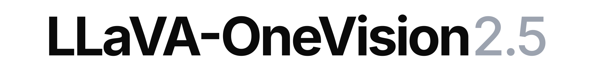

<p align="center">
  <picture>
    <source media="(prefers-color-scheme: dark)" srcset="asset/llava_onevision_2_5_black.svg">
    <source media="(prefers-color-scheme: light)" srcset="asset/llava_onevision_2_5_white.svg">
    
  </picture>
</p>

<p align="center">
  <strong>Fully Open Framework for Democratized Multimodal Training</strong>
</p>

<table align="center">
<tr><td>

> [!IMPORTANT]
> 🌟 **The core work on this project is led by [Glint Lab](https://www.glint-mvt.com).**

</td></tr>
</table>

<p align="center">
👉 <b><a
href="asset/xiaohongshu_group.jpeg">Xiaohongshu Group</a></b> 👈
</p>

<p align="center">
🤗 <b>2.5 <a href="https://huggingface.co/lmms-lab-encoder/LLaVA-OneVision-2.5-4B-Instruct">Models</a></b> · <b>Technical Report (coming soon)</b>
</p>

<p align="center">
🤗 <b>2 <a href="https://huggingface.co/lmms-lab-encoder/LLaVA-OneVision-2-8B-Instruct">Models</a></b> · <b><a href="https://huggingface.co/datasets/mvp-lab/LLaVA-OneVision-2-Data">Datasets</a></b> · <b><a
href="https://arxiv.org/pdf/2605.25979">Technical Report</a></b> · <b><a
href="https://evolvinglmms-lab.github.io/LLaVA-OneVision-2.5/">HomePage</a></b> · <b><a
href="https://huggingface.co/spaces/FeilongTang/OneVision-Encoder-Codec-View">Codec&nbsp;Playground</a></b> · <b><a
href="https://docs.vllm.ai/en/latest/api/vllm/model_executor/models/llava_onevision2/">vLLM</a></b> · <b><a
href="https://discord.gg/PmdGHMFNP">Discord</a></b>
</p>

<p align="center">
  🤗 <b>1.5 <a href="https://huggingface.co/collections/lmms-lab/llava-onevision-15-68d385fe73b50bd22de23713">Models</a></b> · <b><a href="https://huggingface.co/collections/lmms-lab/llava-onevision-15-68d385fe73b50bd22de23713">Datasets</a></b> · <b><a href="https://arxiv.org/abs/2509.23661">Technical Report</a></b> · <b><a href="https://docs.nvidia.com/nemo/automodel/nightly/model-coverage/vlm/lmms-lab/llava-onevision.html">NeMo</a></b> · <b><a href="https://discord.gg/PmdGHMFNP">Discord</a></b>
</p>

---

## NEWS
- 2026-11-18: Released [LLaVA-OneVision-2.5-4B-Instruct](https://huggingface.co/lmms-lab-encoder/LLaVA-OneVision-2.5-4B-Instruct) — one 4B model for offline and streaming video, with its training code.
- 2026-11-05: Thanks to [ResearchBoost-Agent](https://github.com/DAGroup-PKU/ResearchBoost-Agent) for making [LLaVA-OneVision-2-4B](examples/llava_onevision2/quick_start_4b/quick_start.sh) SFT 2.2–3.0× faster! See [Training Acceleration](#training-acceleration) for details.
- 2026-04-30: Released LLaVA-OneVision-2 — next-generation multimodal model, with new [LLaVA-OneVision-2-VideoCaption](#datasets) and [LLaVA-OneVision-2-Spatial](#datasets) datasets.
- 2026-02-10: Released [OneVision-Encoder](https://huggingface.co/collections/lmms-lab-encoder/onevision-encoder-6978aeb2bbe1aa13fad12d4c) — codec-aligned vision encoders, with [Technical Report](https://arxiv.org/abs/2602.08683).
- 2025-12-11: Released RL recipe for LLaVA-OneVision-1.5, with [Project](https://mvp-ai-lab.github.io/LLaVA-OneVision-1.5-RL/), [Code](https://github.com/EvolvingLMMs-Lab/LLaVA-OneVision-1.5-RL), [Data](https://huggingface.co/datasets/mvp-lab/LLaVA-OneVision-1.5-RL-Data), and [Model](https://huggingface.co/mvp-lab/LLaVA-OneVision-1.5-8B-RL).
- 2025-09-30: Released the LLaVA-OneVision-1.5 [Technical Report](https://arxiv.org/abs/2509.23661).


## Contents
<!-- TOC -->
- [Introduction](#introduction)
- [Results](#evaluation-results)
- [Method](#method)
- [Models](#models)
- [Datasets](#datasets)
- [Training Acceleration](#training-acceleration)
- [Citation](#citation)
- [Acknowledgement](#acknowledgement)
- [LLaVA-OneVision-1.5](https://github.com/EvolvingLMMs-Lab/LLaVA-OneVision-1.5/tree/1.5)


## Introduction

**LLaVA-OneVision-2.5** is the latest release of the family. [LLaVA-OneVision-2.5-4B-Instruct](https://huggingface.co/lmms-lab-encoder/LLaVA-OneVision-2.5-4B-Instruct) is a 4B model for single-image, multi-image and video input that is also trained for **streaming** video: frames arrive one at a time, and at every step the model decides whether to stay silent or speak. The same weights and the same chat template serve both modes.

**LLaVA-OneVision-2** is the next-generation release of the LLaVA-OneVision family — a fully open 8B multimodal model that unifies image, long-form video, and spatial understanding under a single architecture, with the entire pipeline (data, encoders, training, checkpoints, logs) released end-to-end.

### 🎬 Codec-Aligned Vision Encoders

Beyond uniform patchification. **OneVision-Encoder** and **OneVision-Encoder-Lang** are HEVC-style vision transformers that add a codec-stream input mode alongside image and uniform-frame video — selecting only motion- and residual-rich patches and sampling dense frames sparsely instead of sparse frames densely. The result is dramatically longer temporal coverage under the same token budget, where prior ViT backbones simply run out of context.

### 🧊 One Model, Every Modality

Most open multimodal models still live in a 2D, single-image world. **LLaVA-OneVision-2-8B-Instruct** breaks out of it — one model, native resolution, no task-specific adapters, no hidden tricks.

- **Long video** — multi-frame reasoning with efficient codec-aligned inference
- **3D-aware spatial reasoning** — depth, layout, object relations
- **Documents, OCR, charts** — structured visual inputs at native resolution

New open-source SOTA across a broad suite of multimodal benchmarks.

### 🚀 Fully Open, Reproducible from Day One

Four datasets ship with the LLaVA-OneVision family — two new for 2, two carried forward from 1.5:

- **LLaVA-OneVision-2-VideoCaption** — extremely dense video captions
- **LLaVA-OneVision-2-Spatial** — 3D-aware spatial reasoning
- **LLaVA-OneVision-1.5-Mid-Training-85M** — 85M concept-balanced mid-training corpus
- **LLaVA-OneVision-1.5-Instruct** — full instruction-tuning mixture

And unlike most "open" releases, *everything* ships alongside them: encoder weights, training code, configs, and full training logs. Reproducible end to end.

## Evaluation Results

<p align="center">
  <picture>
    <source media="(prefers-color-scheme: dark)" srcset="asset/llava_onevision2_5_performance_dark_anim.svg">
    <source media="(prefers-color-scheme: light)" srcset="asset/llava_onevision2_5_performance_light_anim.svg">
    
  </picture>
</p>

<sub>Compared with Qwen3.5-4B, thinking disabled; `--` means not available. VideoMME is the mean over the short, medium and long splits. Each side reports its best score over the settings tried, from single runs; the setting behind each video score is listed in the [model card](https://huggingface.co/lmms-lab-encoder/LLaVA-OneVision-2.5-4B-Instruct#performance). The image block shows selected benchmarks; full results, settings and protocol will be given in the technical report.</sub>

## Method

### Codec-Style Patch Selection

<p align="left">
  <picture>
    <source media="(prefers-color-scheme: dark)" srcset="asset/method_codec_selection_dark.svg">
    <source media="(prefers-color-scheme: light)" srcset="asset/method_codec_selection_light.svg">
    
  </picture>
</p>

Standard video pipelines uniformly sample a handful of frames and process **every** patch — most of it static background. We borrow from HEVC: keep **I-frames** dense, keep only **motion- and residual-rich patches** from **P-frames**. Same 54-token budget, **18 frames** instead of 6 — 3× the temporal range, no extra LLM context, no input-type adapters.

### One Encoder, Every Modality

<p align="left">
  <picture>
    <source media="(prefers-color-scheme: dark)" srcset="asset/method_unified_encoder_dark.svg">
    <source media="(prefers-color-scheme: light)" srcset="asset/method_unified_encoder_light.svg">
    
  </picture>
</p>

Most multimodal stacks ship a different tokenizer per input type — one path for images, another for video, a third for multi-image. We don't. **Image, uniform frames, and codec-aligned tokens** all flow into the **same OneVision-Encoder** under a shared `(t, h, w)` position scheme. No task-specific tokenizers, no per-modality routing.

### Four-Stage Training Curriculum

We train LLaVA-OneVision-2 in four compact stages:

1. **Bootstrap video ability** from LLaVA-OneVision-1.5 with short 30s video captions.
2. **Instruction tune** with large multimodal instruction data and 30–180s video captions.
3. **Extend to long videos** with 10–15 min captions and public video instruction data.
4. **Refine codec, spatial, and tracking skills** with denser long-video sampling, point tracking, and 4M spatial samples.

The curriculum mixes LLaVA-OneVision-1.5 data, FineVision, and new in-house video caption/spatial datasets; we do not synthesize any video instruction data.


## Models

| Model                           | HF Link                                                                                                                                                                                                                                                       | Training Log                                                                                                                                                                                                                                                                              |
| ------------------------------- | ------------------------------------------------------------------------------------------------------------------------------------------------------------------------------------------------------------------------------------------------------------- | ----------------------------------------------------------------------------------------------------------------------------------------------------------------------------------------------------------------------------------------------------------------------------------------- |
| LLaVA-OneVision-2.5-4B-Instruct | [](https://huggingface.co/lmms-lab-encoder/LLaVA-OneVision-2.5-4B-Instruct) |  |
| LLaVA-OneVision-2-8B-Instruct | [](https://huggingface.co/lmms-lab-encoder/LLaVA-OneVision-2-8B-Instruct)                                                         |                                                                                                                                                                                                        |
| LLaVA-OneVision-2-4B-Instruct |                                                                                                                                                                            |                                                                                                                                                                                                        |
| LLaVA-OneVision-1.5-4B-Instruct | [](https://huggingface.co/lmms-lab/LLaVA-OneVision-1.5-4B-Instruct)                                                                 | [](https://huggingface.co/lmms-lab/LLaVA-OneVision-1.5-4B-Instruct/tensorboard)                                                                             |
| LLaVA-OneVision-1.5-8B-Instruct | [](https://huggingface.co/lmms-lab/LLaVA-OneVision-1.5-8B-Instruct)                                                                 | [](https://huggingface.co/lmms-lab/LLaVA-OneVision-1.5-8B-Instruct/tensorboard)                                                                             |
| OneVision-Encoder               | [](https://huggingface.co/lmms-lab-encoder/onevision-encoder-large)                                                     |                                                                                                                                                                                                        |
| OneVision-Encoder-Lang          | [](https://huggingface.co/lmms-lab-encoder/onevision-encoder-large-lang)                                     |                                                                                                                                                                                                        |

## Datasets

| Description                          | Link                                                                                                                                                                                                                                                                            | Status                                                                                                          |
| ------------------------------------ | ------------------------------------------------------------------------------------------------------------------------------------------------------------------------------------------------------------------------------------------------------------------------------- | --------------------------------------------------------------------------------------------------------------- |
| LLaVA-OneVision-2-VideoCaption     | [](https://huggingface.co/datasets/mvp-lab/LLaVA-OneVision-2-Data/tree/main/mid_training_video)                                                      |                                   |
| LLaVA-OneVision-2-Spatial          | [](https://huggingface.co/datasets/mvp-lab/LLaVA-OneVision-2-Data/tree/main/spatial)                                                                           |                                   |
| LLaVA-OneVision-1.5-Mid-Training-85M | [](https://huggingface.co/datasets/mvp-lab/LLaVA-OneVision-1.5-Mid-Training-85M)                                                            |                                   |
| LLaVA-OneVision-1.5-Instruct         | [](https://huggingface.co/datasets/mvp-lab/LLaVA-OneVision-1.5-Instruct-Data)                                                                     |                                   |

<p align="center">
  <picture>
    <source media="(prefers-color-scheme: dark)" srcset="asset/llava_onevision2_data_distribution_dark_anim.svg">
    <source media="(prefers-color-scheme: light)" srcset="asset/llava_onevision2_data_distribution_light_anim.svg">
    
  </picture>
</p>


## Training Acceleration

Training infrastructure optimizations by [ResearchBoost-Agent](https://github.com/DAGroup-PKU/ResearchBoost-Agent) make the 4B quick-start SFT 2.2–3.0× faster. Pick the preset that matches your GPUs:

| Preset | GPU Architecture | Peak memory per GPU | Speed-up |
|---|---|---|---|
| `blackwell` | Blackwell | 157.6 GiB | 3.0× |
| `hopper_80g` | Hopper | 74.8 GiB | 2.2× |

```bash
OV2_PRESET=blackwell bash examples/llava_onevision2/quick_start_4b/quick_start.sh
```

Without a preset, training runs exactly as before. See [docs/faster_training.md](docs/faster_training.md) for how to set up the environment for accelerated training and for details on each speed-up switch.

## Contributors
Thanks so much to all of our amazing contributors!

<!-- readme: collaborators,contributors,jiankangdeng/- -start -->
<p align="center">
  <a href="https://evolvinglmms-lab.github.io/LLaVA-OneVision-2.5/projects/index.html#contributors">
    <picture>
      <source media="(prefers-color-scheme: dark)" srcset="asset/contributors_dark.svg">
      <source media="(prefers-color-scheme: light)" srcset="asset/contributors_light.svg">
      
    </picture>
  </a>
  <br />
  <a href="https://evolvinglmms-lab.github.io/LLaVA-OneVision-2.5/projects/index.html#contributors"><strong>Explore all contributors &rarr;</strong></a>
</p>
<!-- readme: collaborators,contributors,jiankangdeng/- -end -->

## Citation

If you find LLaVA-OneVision-2 useful in your research, please cite the following paper:

```bibtex
@misc{an2026llavaonevision2nextgenerationperceptualintelligence,
  title         = {LLaVA-OneVision-2: Towards Next-Generation Perceptual Intelligence},
  author        = {Xiang An and Yin Xie and Feilong Tang and Yunyao Yan and Huajie Tan and Didi Zhu and Changrui Chen and Xiuwei Zhao and Bin Qin and Kaicheng Yang and Yifei Shen and Yuanhan Zhang and Kaichen Zhang and Wenkang Zhang and Zheng Cheng and Nansen Zhang and Chunsheng Wu and Chunjiang Ge and Zimin Ran and Dehua Song and Chunyuan Li and Shikun Feng and Ming Hu and Zhangquan Chen and Junbo Niu and Bo Li and Ziyong Feng and Ziwei Liu and Zongyuan Ge and Jiankang Deng},
  year          = {2026},
  eprint        = {2605.25979},
  archivePrefix = {arXiv},
  primaryClass  = {cs.CV},
  url           = {https://arxiv.org/abs/2605.25979}
}

@misc{an2025llavaonevision15fullyopenframework,
  title         = {LLaVA-OneVision-1.5: Fully Open Framework for Democratized Multimodal Training},
  author        = {Xiang An and Yin Xie and Kaicheng Yang and Wenkang Zhang and Xiuwei Zhao and Zheng Cheng and Yirui Wang and Songcen Xu and Changrui Chen and Didi Zhu and Chunsheng Wu and Huajie Tan and Chunyuan Li and Jing Yang and Jie Yu and Xiyao Wang and Bin Qin and Yumeng Wang and Zizhen Yan and Ziyong Feng and Ziwei Liu and Bo Li and Jiankang Deng},
  year          = {2025},
  eprint        = {2509.23661},
  archivePrefix = {arXiv},
  primaryClass  = {cs.CV},
  url           = {https://arxiv.org/abs/2509.23661}
}

@misc{tang2026onevisionencodercodecalignedsparsityfoundational,
  title         = {OneVision-Encoder: Codec-Aligned Sparsity as a Foundational Principle for Multimodal Intelligence},
  author        = {Feilong Tang and Xiang An and Yunyao Yan and Yin Xie and Bin Qin and Kaicheng Yang and Yifei Shen and Yuanhan Zhang and Chunyuan Li and Shikun Feng and Changrui Chen and Huajie Tan and Ming Hu and Manyuan Zhang and Bo Li and Ziyong Feng and Ziwei Liu and Zongyuan Ge and Jiankang Deng},
  year          = {2026},
  eprint        = {2602.08683},
  archivePrefix = {arXiv},
  primaryClass  = {cs.CV},
  url           = {https://arxiv.org/abs/2602.08683}
}

@article{li2025llavaonevisioneasyvisualtasktransfer,
  title         = {LLaVA-OneVision: Easy Visual Task Transfer},
  author        = {Bo Li and Yuanhan Zhang and Dong Guo and Renrui Zhang and Feng Li and Hao Zhang and Kaichen Zhang and Peiyuan Zhang and Yanwei Li and Ziwei Liu and Chunyuan Li},
  journal       = {Transactions on Machine Learning Research},
  year          = {2025},
  url           = {https://openreview.net/forum?id=zKv8qULV6n}
}
```

## Acknowledgement

We extend our sincere gratitude to the [**LoongForge**](https://github.com/baidu-baige/LoongForge) team from Baidu AI Cloud for providing the exceptional AIAK-based training framework. The outstanding capabilities of AIAK-Training-LLM and AIAK-Megatron have significantly accelerated our training process with remarkable efficiency. We are especially grateful for their citation of LLaVA-OneVision-2 and deeply appreciate their recognition and support.

We acknowledge the support of [Synvo AI](https://synvo.ai/) for contributing to the partial data annotation in this work, and also thank the maintainers and contributors of the following open-source projects, whose work greatly inspired and supported our research:

- LLaVA: Large Language-and-Vision Assistant — [LLaVA](https://github.com/haotian-liu/LLaVA)
- LLaVA-NeXT: Next-generation multi-modal assistant — [LLaVA-NeXT](https://github.com/LLaVA-VL/LLaVA-NeXT)
- lmms-eval: A standardized evaluation framework for Large Multimodal Models — [lmms-eval](https://github.com/EvolvingLMMs-Lab/lmms-eval)
- Megatron-LM: Efficient, scalable training for large language models — [Megatron-LM](https://github.com/NVIDIA/Megatron-LM)
- Qwen2.5-VL: Strong vision-language foundation model — [Qwen2.5-VL](https://github.com/QwenLM/Qwen2.5-VL)
- InternVL: Open-source large-scale vision-language foundation model — [InternVL](https://github.com/OpenGVLab/InternVL)
- Qwen3: Next-generation Qwen LLM — [Qwen](https://github.com/QwenLM/Qwen)
- MetaCLIP: Scalable contrastive pretraining — [MetaCLIP](https://github.com/facebookresearch/MetaCLIP)
- FineVision: Open Data Is All You Need — [FineVision](https://huggingface.co/spaces/HuggingFaceM4/FineVision)
